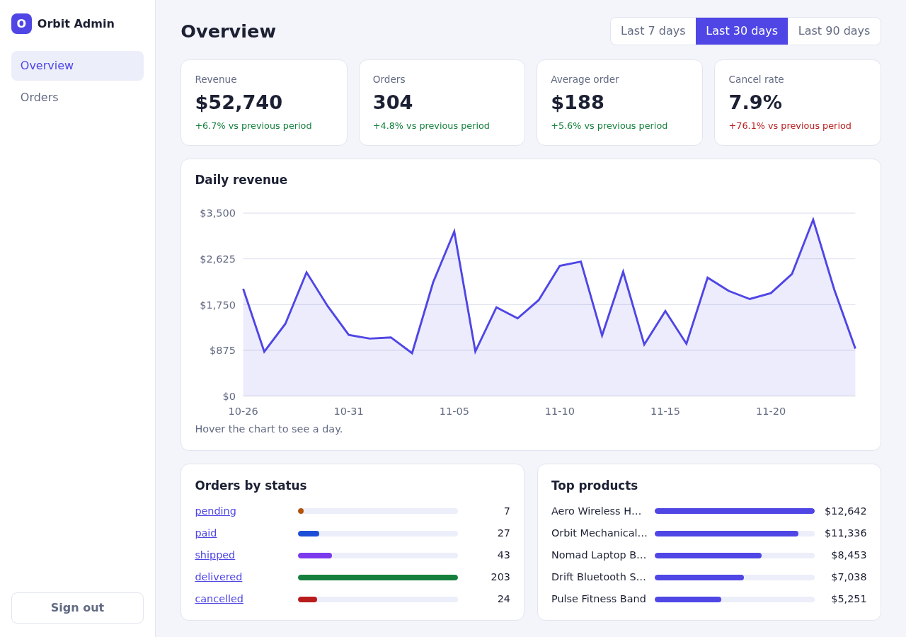
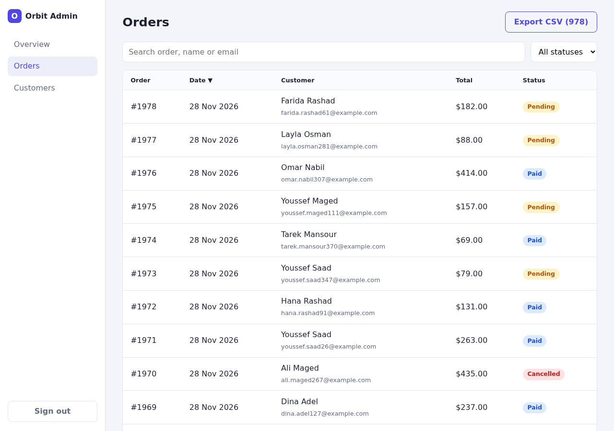

# Orbit Admin: sales dashboard for an online shop

An admin dashboard for a small online shop. The owner sees revenue and order trends at a glance, then finds and updates individual orders.

**Live demo:** _add link after deploy_ · Demo login: `admin@orbit.demo` / `orbit-demo`




## What it does

- **Overview:** revenue, orders, average order value and cancel rate for the last 7, 30 or 90 days, each compared with the previous period of the same length. Daily revenue chart with hover readout, orders by status, top products.
- **Orders:** search by order number, name or email; filter by status; sort any column; pagination; export the filtered list as CSV.
- **Order detail:** items, totals and customer. Move an order forward (paid, shipped, delivered) or cancel it, with a confirmation for cancelling.
- **Sign-in screen** with protected routes.
- **Phone friendly:** layout, tables and cards adapt to small screens.

## How it works

- **React + Vite + React Router.** Filters live in the URL (`/orders?status=paid&q=omar`), so a filtered view survives refresh and can be shared. The status bars on the overview link to filtered views.
- **All logic is outside the components** (`src/lib`) and covered by tests: filtering, sorting, pagination, status rules, revenue stats, CSV export.
- **Cancelled orders never count as revenue**, customers or average order value. One function (`countsAsRevenue`) decides this, so the numbers cannot disagree.
- **Status changes follow rules.** Orders only move forward, and can be cancelled only before they ship. Invalid moves are ignored in the logic, not only hidden in the UI.
- **Period comparison** returns `n/a` instead of infinity when the previous period has no data.
- **Charts are hand-written SVG.** No chart library: nothing hidden, small bundle (about 88 kB gzipped total).
- **CSV export escapes quotes and commas**, and neutralises cells that start with `=`, `+`, `-` or `@` so a malicious customer name cannot run as a spreadsheet formula.
- **Dates are local `YYYY-MM-DD` strings**, not UTC timestamps.

## Tradeoffs and what I would do next

- **The data is fake.** About 1,000 orders are generated in the browser from a fixed random seed, so the demo looks the same each time. Status changes are saved in localStorage only. A real version needs an API and a database.
- **The login is a demo.** It compares against a hard-coded password in the browser and protects nothing. A real version verifies credentials on a server and uses a session cookie or token, with server-side checks on every request.
- **No tests for the React components yet.** The logic is tested; UI is checked by hand and with screenshots.
- **Next:** customers page, product stock, date-range picker, and a real backend.

## Run it locally

```bash
npm install
npm run dev      # http://localhost:5173
npm test         # 19 tests on the logic in src/lib
npm run build
```

## Structure

```
src/
  pages/        Login, Overview, Orders
  components/   Layout, KpiCard, LineChart, StatusBadge, OrderDrawer
  hooks/        useAuth, useOrders (state + localStorage)
  lib/          orders, stats, csv, dates, format, auth (+ tests)
  data/         seeded demo data generator
```
